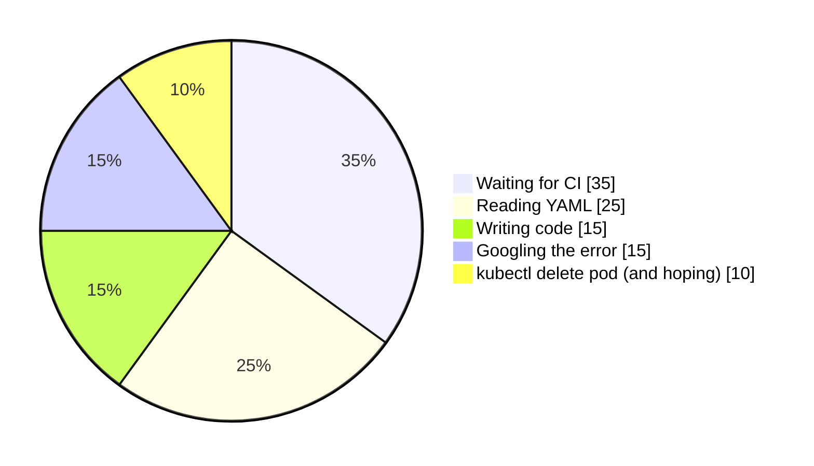
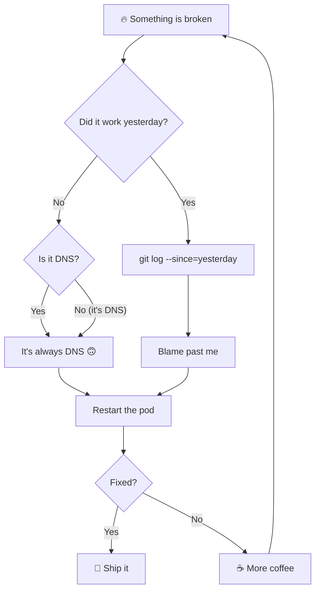

<div align="center">


</div>

```console
$ kubectl describe human ruimin
Name:         ruimin
Namespace:    beijing
Labels:       role=ai-infra
              mood=compiling
Containers:
  brain:
    Image:    go:latest + python:3
    Limits:   coffee=unlimited
Conditions:
  Type        Status
  Curious     True
  Sleepy      Unknown
Events:
  Normal  Scheduled  just now  Waiting for the next interesting bug
```

## 🐍 My contributions, being eaten

<picture>
  <source media="(prefers-color-scheme: dark)" srcset="https://raw.githubusercontent.com/dreaming66/dreaming66/output/github-snake-dark.svg" />
  
</picture>

## 🥧 Where my time actually goes



## 🧭 My debugging algorithm



## 🤹 Today's joke (refresh for another)

<div align="center">


</div>

## 🔁 Daily loop

```python
while alive:
    coffee += 1
    if cluster.is_on_fire():
        kubectl("describe", "pod", cluster.loudest_pod())
    elif ci.is_green():
        celebrate()          # rare event, handle with care
    else:
        wait_for_ci()        # 90% of runtime
    sleep(random.choice([0, 0, 0, 8]))  # sleep is a best-effort operation
```

## 💬 Words to live by

<div align="center">


</div>

<details>
<summary>🚫 <b>Do not click</b></summary>

<br />

```console
$ kubectl delete namespace production
namespace "production" deleted

$ echo "just kidding"
just kidding
```

You clicked anyway. A true infra engineer. 🫡 You are now on call.

</details>

<div align="center">

**Go · Python · Kubernetes · Docker · Shell · TypeScript / React**

*"It works on my cluster."* 🚢

```text
      /\_/\      sudo make me a sandwich
     ( o.o )     > okay.
      > ^ <
```

</div>
