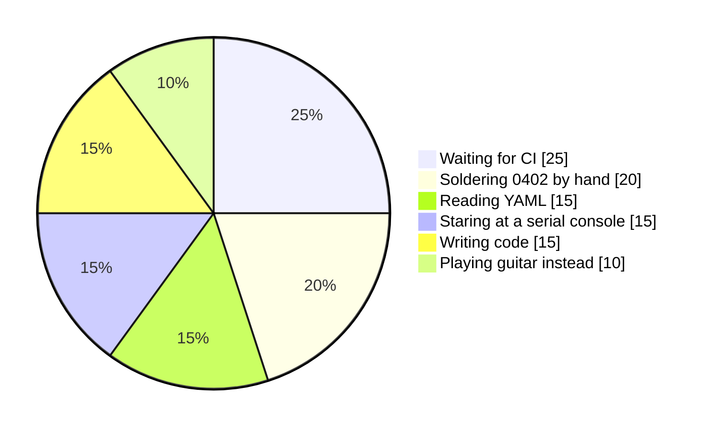
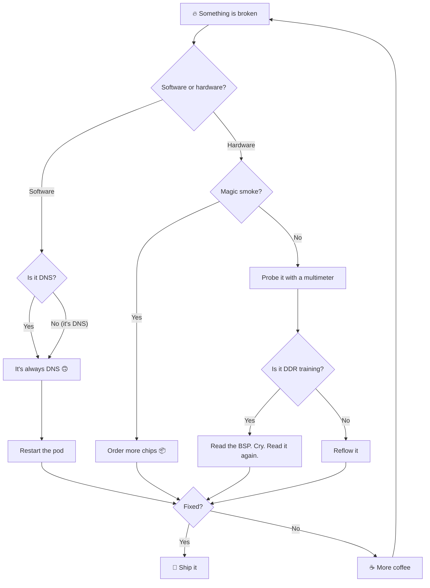

<div align="center">


<a href="https://me.dustinz.de"></a>
<a href="https://me.dustinz.de/?lang=zh"></a>
<a href="https://me.dustinz.de/?lang=en"></a>
<a href="https://me.dustinz.de/?lang=ja"></a>


<br /><br />

<a href="https://me.dustinz.de/#aura"></a>

<sub>Five <b>AuraCore</b> boards (my own Allwinner H616 SBC) on their USB-networked base, running k3s. <a href="https://me.dustinz.de/#aura">Spin it in 3D →</a></sub>

</div>

```console
$ kubectl describe human ruimin
Name:         ruimin
Namespace:    homelab
Labels:       role=ai-infra
              role=maker
              callsign=BH3FWY
              mood=soldering
Containers:
  brain:
    Image:    go:latest + python:3 + easyeda
    Limits:   coffee=unlimited, solder=63/37
  hands:
    Image:    soldering-iron:350C
Conditions:
  Type        Status
  Curious     True
  Sleepy      Unknown
  OnFire      False   (last seen: BeSafe, 2024 — see /archive)
Events:
  Normal  Scheduled  just now  Waiting for the next interesting bug
```

## 🔩 What I'm building

| | Project | Status |
|---|---|---|
| 🟢 | **AuraCore** — Allwinner H616 SBC, 6-layer, 31 × 60 mm, hand-soldered; five of them on a USB-networked base → one k3s cluster | runs mainline U-Boot / Linux · chasing a DDR-training bug under the vendor BSP |
| 🟠 | **RK3576 board**, 38 × 38 mm, for edge inference on its 6 TOPS NPU | schematic done · placement & routing |
| 🟠 | **Low-cost humanoid** based on Berkeley Humanoid Lite — cycloidal joints, my own FOC driver, gait trained with RL in MJX | joints printed & assembled · tuning drivers |
| 🟠 | **SDR** on ZYNQ-7010 + AD936x, my own board | drawing the board |
| 📚 | LLM training & fine-tuning, moving upstream from inference | learning |
| 🎸 | Electric guitar, J-rock · piano | forever WIP |

<sub>Day job: deploying and tuning LLM inference (PD disaggregation, quantization, K8s). Every demo above is playable on <a href="https://me.dustinz.de">the homepage</a> — solder a board, boot it over serial, tune into the Morse beacon, strum the guitar.</sub>

## 🚢 Upstream

- [](https://github.com/kubernetes-sigs/kueue/pull/17528) **kubernetes-sigs/kueue#17528** — v1alpha1 API reference, live on the docs site
- [](https://github.com/kubernetes-sigs/kueue/pull/17527) **kubernetes-sigs/kueue#17527** — gate for the TAS scheduling-library tests
- [](https://github.com/kubernetes-sigs/reference-docs/pull/476) **kubernetes-sigs/reference-docs#476** — genref: support json tag options

## 📼 From the archive

- [**omni_haha**](https://github.com/dreaming66/omni_haha) — a three-wheel omni base: GD32F103 + LV8731V steppers, my own kinematics and ROS serial protocol, YDLIDAR mapping
- **py-apple quadruped**, rebuilt from [ToanTech/py-apple-quadruped-robot](https://github.com/ToanTech/py-apple-quadruped-robot) — my first robot that walked
- **Monocular autonomous flight** — ORB-SLAM3 + MiDaS depth + EGO-Planner
- **[me.dustinz.de](https://me.dustinz.de)** — the homepage itself: hand-written Canvas2D / WebGL / WebAudio, zero frameworks, zero audio samples ([source](https://github.com/dreaming66/dreaming66.github.io))

## 🐍 My contributions, being eaten

<picture>
  <source media="(prefers-color-scheme: dark)" srcset="https://raw.githubusercontent.com/dreaming66/dreaming66/output/github-snake-dark.svg" />
  
</picture>

## 🥧 Where my time actually goes



## 🧭 My debugging algorithm



## 🔁 Daily loop

```python
while alive:
    coffee += 1
    if cluster.is_on_fire():
        kubectl("describe", "pod", cluster.loudest_pod())
    elif board.smells_like_smoke():
        power_off(); reconsider_life_choices()
    elif ci.is_green():
        celebrate()          # rare event, handle with care
    else:
        pick_up(guitar)      # 90% of runtime
    sleep(random.choice([0, 0, 0, 8]))  # sleep is a best-effort operation
```

## 🤹 Today's joke (refresh for another)

<div align="center">


</div>

<details>
<summary>🚫 <b>Do not click</b></summary>

<br />

```console
$ kubectl delete namespace production
namespace "production" deleted

$ echo "just kidding"
just kidding

$ echo "73 de BH3FWY"
73 de BH3FWY
```

You clicked anyway. A true infra engineer. 🫡 You are now on call — and on the air.

</details>

<div align="center">

**Go · Python · C · Kubernetes · Docker · Linux / U-Boot / Buildroot · STM32 / ESP32 · EasyEDA · TypeScript**

*"It works on my cluster."* 🚢 · *"It boots on my board."* 🔩

```text
      /\_/\      sudo make me a sandwich
     ( o.o )     > okay. soldering one now.
      > ^ <
```

</div>
